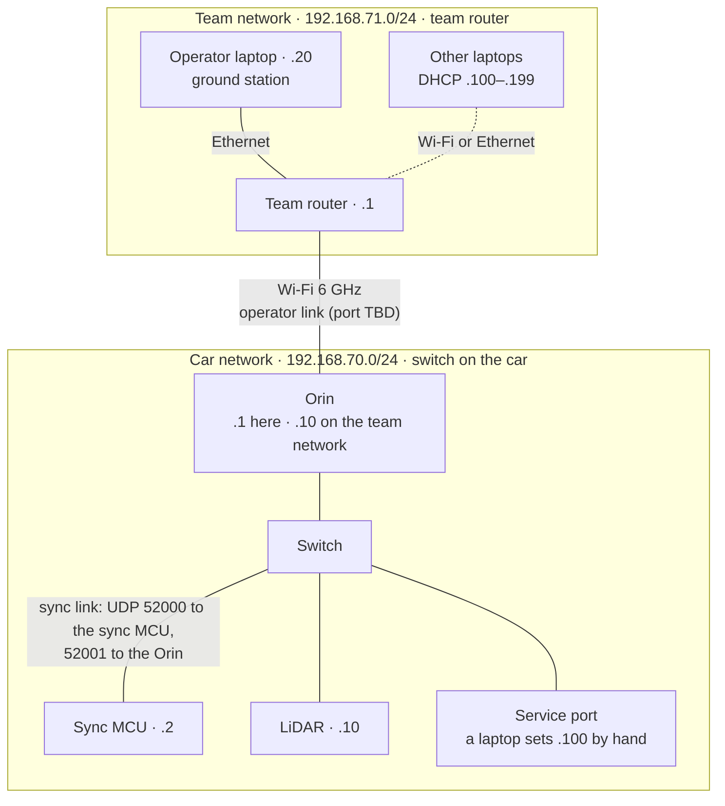

# ICD-network

- **Revision:** A (2026-10-25)
- **Status:** Draft. Addresses proposed (TBC); ports and rates set 2026-10-25. Owners: Shrikar Vempati on both sides until reassigned.
- **Side A:** the car: the Orin, the sync MCU, the LiDAR and the switch (E-02, E-06, E-09, E-10, E-30) (owner: Shrikar Vempati, until reassigned)
- **Side B:** the ground equipment: the team router, the operator's laptop, other laptops (ADR-0015) (owner: Shrikar Vempati, until reassigned)
- **Traces to:** SYS-04, SYS-24, SYS-26, SYS-27, ADR-0015, ADR-0021, ADR-0031, ADR-0047, ADR-0049

Every network the car is on, every address on them, and the ports and rates of the traffic between them. What the messages contain is in the link ICDs: [sync-link](sync-link.md) for the sync MCU and the Orin, operator-link (TBD) for the laptop and the Orin.

The twin uses the same addresses (ADR-0047), so nothing changes between the simulation and the car.

## Topology

When the team network isn't there, the car's hotspot button (E-08) turns the Orin's Wi-Fi into its own network instead (below).

## Networks

| Network | Range | Who's on it | Gateway and DHCP |
| --- | --- | --- | --- |
| **Car network** (Ethernet, the switch E-06) | 192.168.70.0/24 (TBC) | Orin, sync MCU, LiDAR, the service port (E-09) | None. Every address is fixed |
| **Team network** (the team router, ADR-0015) | 192.168.71.0/24 (TBC) | The car (the Orin's Wi-Fi), the operator's laptop, other laptops | The router hands out addresses. Only the car gets a gateway: the operator's laptop (ADR-0015) |
| **Car hotspot** (button E-08, 5 GHz) | 192.168.72.0/24 (TBC) | The car, laptops that join it | The car hands out addresses, with no gateway |

The ranges avoid the defaults of home routers and of the team router (GL.iNet uses 192.168.8.0/24), so a laptop on two networks never sees the same range twice.

## Addresses

| Device | Network | Address | Set by |
| --- | --- | --- | --- |
| Orin, Ethernet | Car | 192.168.70.1 | Static, in the platform image |
| Sync MCU | Car | 192.168.70.2 | Static, in its firmware's configuration |
| LiDAR (Hokuyo) | Car | 192.168.70.10 | Set once on the sensor (its factory address is 192.168.0.10) |
| A laptop on the service port | Car | 192.168.70.100 | By hand on the laptop |
| Team router | Team | 192.168.71.1 | Router configuration |
| Orin, Wi-Fi | Team | 192.168.71.10 | A reservation on the router |
| Operator's laptop | Team | 192.168.71.20 | A reservation on the router |
| Other laptops | Team | 192.168.71.100–199 | DHCP, no gateway |
| Orin, Wi-Fi | Hotspot | 192.168.72.1 | Static, in the platform image |
| Laptops | Hotspot | 192.168.72.100–199 | DHCP from the Orin |

All TBC with the ranges.

## Ports and rates

| Traffic | From → to | Port | Rate | Defined in |
| --- | --- | --- | --- | --- |
| Sync link, into the sync MCU | Orin → sync MCU | UDP 52000 | — | [sync-link](sync-link.md) |
| Sync link, into the Orin | sync MCU → Orin | UDP 52001 | — | [sync-link](sync-link.md) |
| Drive commands | Orin → sync MCU | (sync link) | As the commander sends them, latest wins; up to 500 Hz, the command bus's rate (SYS-06) | [sync-link](sync-link.md) |
| Operator heartbeat | Laptop → Orin → sync MCU | operator link, then sync link | 50–100 Hz (ADR-0015) | [sync-link](sync-link.md) |
| Safety state | sync MCU → Orin | (sync link) | On change, plus 50 Hz | [sync-link](sync-link.md) |
| Operator link (teleop, heartbeat, re-arm) | Laptop ↔ Orin | TBD | 50–100 Hz (ADR-0015) | operator-link (TBD) |
| Time sync (PTP) | sync MCU ↔ Orin | UDP 319, 320 (PTP's standard ports) | PTP's | ADR-0021 |
| LiDAR | LiDAR → Orin | TCP 10940 (Hokuyo's) | 40 Hz scans | E-10 |

## In the twin

The twin builds the same networks in Docker, at the same addresses (ADR-0047):

| Container | Networks | Address |
| --- | --- | --- |
| Orin (the platform image) | Car, team | 192.168.70.1, 192.168.71.10 |
| Sync MCU firmware (`native_sim`) | Car | 192.168.70.2 |
| LiDAR emulator | Car | 192.168.70.10 |
| Ground station | Team | 192.168.71.20 |

- **Network impairment:** delay and loss on the operator link are applied in simulated time, by a proxy between the ground station and the Orin (ADR-0049).
- **Single-machine tests** keep using 127.0.0.1, for example the firmware-in-the-loop test.

## Open issues

1. ~~Owners on both sides~~ **Set (2026-10-25):** Shrikar Vempati on both sides until reassigned.
2. The address ranges and addresses above: TBC until the router and the car are set up.
3. The operator link's port, with the operator-link ICD.
4. Who the sync MCU accepts messages from: open issue 6 in [sync-link](sync-link.md). The service port puts a laptop on the car network.
