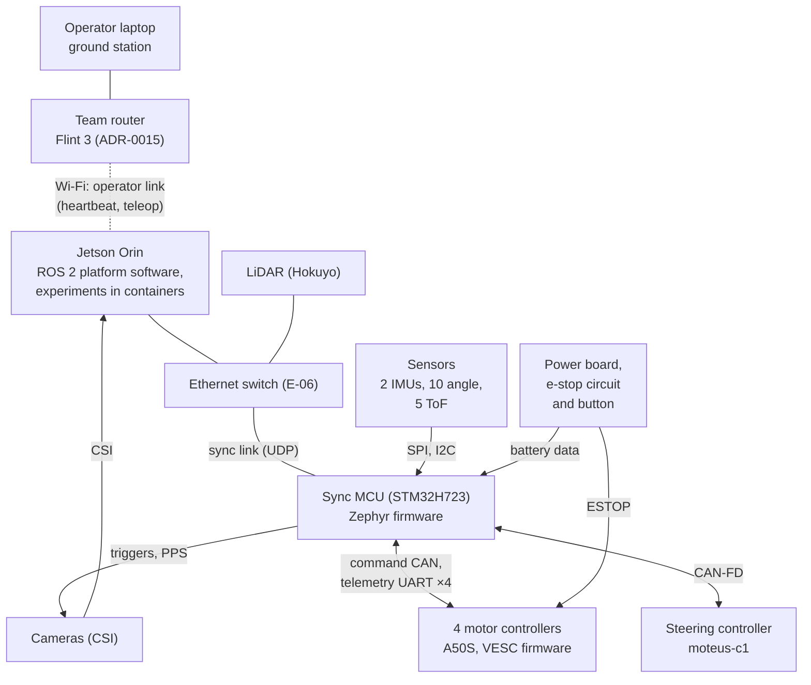
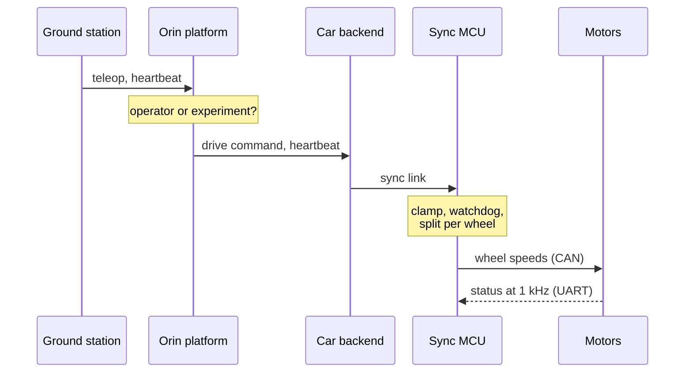

# Software architecture (v1)

- **Status:** Draft (2026-10-25). Every component is scaffolded ([`setup-plan.md`](setup-plan.md)) and almost nothing is implemented yet; what's left is in [`platform-plan.md`](platform-plan.md). Where to start, per component: [`handoff/software.md`](../handoff/software.md).
- **Decisions:** ADR-0028 (targets), ADR-0029 (dev environment), ADR-0031 (sync-link encoding), ADR-0032 (simulators), ADR-0033 and ADR-0037 (VESC firmware in this repo), ADR-0034 (off-the-shelf motor controllers), ADR-0047 (one platform for every target), ADR-0049 (the twin's clock); also ADR-0015 (ground link), ADR-0016 (Orin platform), ADR-0017 (Zephyr), ADR-0021 (time sync), ADR-0024 (telemetry latency), ADR-0035, ADR-0038 and ADR-0039 (stops and resets). ADR-0048 (experiments own estimation and control).
- **Requirements:** SYS-33 (targets) and the software-facing requirements SYS-04 to SYS-09, SYS-11, SYS-19, SYS-21 to SYS-25, SYS-29, SYS-30.

This page explains the car's software for someone who has never seen it: what runs where, how the pieces talk, what happens in the situations that matter, and how the same software runs in simulation, on development boards and on the car. The decisions and numbers live in the ADRs, ICDs and requirements it links to; where this page and those disagree, those win.

## The car in one paragraph

ARC's car is a 1/10-scale four-wheel-drive research car (see [`architecture.md`](../architecture.md)). Engineers on the team use it to try ideas in software: state estimation, localization, planning, control, and later learned policies. The software therefore has two jobs that pull against each other. It must let anyone run almost anything (an **experiment**), and it must keep the car safe and recorded whatever that experiment does.

The **platform** is everything the team maintains so that experiments can be written quickly and can't hurt the car: the firmware, the safety functions, the drivers, logging, the operator's ground station and the simulator. It provides measurements, not interpretations: estimating where the car is, deciding where it goes and how to steer it are all experiment work (ADR-0048).

## The computers and how they're connected



| Computer | What it is | Software | Lives in |
| --- | --- | --- | --- |
| **Operator laptop** | Any team member's laptop at the track | The ground station: drive with a gamepad, keep the car alive with a heartbeat, watch telemetry, pull logs | Not scaffolded yet (#71); a working version is on branch `yufeng/ground-station` |
| **Jetson Orin** | The car's main computer. v1.0: the Orin Nano 8 GB developer kit; v1.1: the Orin NX 16 GB (ADR-0046) | JetPack 7.2.1, Ubuntu 24.04, ROS 2 Jazzy, PREEMPT_RT (ADR-0016). The **platform software** runs here, and so do **experiments**, each in its own container | `ros/`, `experiments/`, `platform/` |
| **Sync MCU** | An STM32H723 microcontroller on the motherboard (ADR-0042) | Zephyr firmware (ADR-0017). Owns the car's clock, reads every vehicle-state sensor, commands the motors and steering, and enforces the safety envelope and heartbeat watchdog | `firmware/sync-mcu/` |
| **Motor controllers** | Four off-the-shelf A50S boards on the deck, one per wheel (ADR-0034) | Upstream VESC firmware plus our modules: e-stop braking, command timeout, telemetry, speed limit | `firmware/vesc/` |
| **Steering controller** | An off-the-shelf moteus-c1 (ADR-0019) | Its own firmware; we keep its configuration | Not in the repo yet |

**Why a separate microcontroller?** The Orin runs Linux, which can pause a program for milliseconds at any time. Anything that must happen on time, every time, runs on the sync MCU instead: timestamping sensor samples to the microsecond (SYS-07), the 150 ms heartbeat watchdog (SYS-04), the safety envelope (SYS-22) and the any-corner stop (SYS-25). The Orin is "soft real-time": fast, but not guaranteed (ADR-0016).

## The layers

Each layer talks only to the one beside it, through a written interface (an ICD).

```
 Experiment (a container)     estimation, localization, planning,
                              control, learned policies
    │  experiment command: speed, acceleration limit, steering (ADR-0048)
 Platform software (ROS 2)    operator link, operator/experiment
                              switch, logging, health
    │  car interface: arc_msgs (ICD ros2-msgs)
 Car backend and drivers      the Orin's end of the sync link;
                              LiDAR and camera drivers
    │  sync link: MAVLink 2 over UDP (ICD-sync-link)
 Sync MCU firmware (Zephyr)   clock, sensors, envelope, watchdog,
                              CAN and UART
    │  command CAN · a telemetry UART per controller · steering CAN-FD
 Motor controllers, steering  motor control, e-stop braking,
                              command timeout
```

- **Experiments never talk to motors.** An experiment sends one vehicle command (speed, acceleration limit, steering angle). The platform passes it through the safety envelope on the sync MCU (SYS-22), and the sync MCU turns it into the four wheels' speeds.
- **Any number of experiments may run** (ADR-0048). How they fit together (which one commands the car, how they share data) is a question for later, not platform work.
- **Experiments can run in real time** on cores kept for them, below the platform's priority (ADR-0048).
- **Experiments can't take the platform down.** Each runs in its own container with CPU, memory, GPU and disk limits (SYS-21). If it crashes, the platform still drives, logs and stops.
- **The platform logs every run,** not the experiment, so a crashed experiment still leaves a complete log (SYS-24).

## How things flow

### A drive command, from the gamepad to the wheels



1. The ground station sends teleop and a **heartbeat** over the operator link: a fixed-rate UDP stream with sequence numbers, marked as top-priority traffic on the router (ADR-0015, rule 4).
2. On the Orin, `arc_safety` receives both. It forwards the heartbeat towards the sync MCU and hands the teleop to `arc_control`.
3. `arc_control` picks what drives: its mode says the operator or the experiment, and a silent source is replaced by the zero command ([ICD-ros2-msgs](../icd/ros2-msgs.md), "Choosing who drives").
4. The car backend packs the command and the heartbeat into MAVLink messages on the sync link.
5. The sync MCU clamps the command to the **safety envelope** (speed, acceleration and steering limits; 3 m/s by default for a new experiment, SYS-22).
6. It splits the clamped command into a speed for each wheel. In a turn each wheel follows a different arc, so the outer wheels turn faster than the inner ones. The split uses the car's geometry from its car configuration. The sync MCU sends one speed to each motor controller, and the steering angle to the steering controller.
7. Each motor controller holds its wheel at that speed with its own control loop (ADR-0048).
8. Teleop from gamepad to wheel must take ≤ 20 ms (p95, SYS-11).

The heartbeat goes through the Orin on purpose: if the Orin hangs, it stops forwarding, and the car stops (ICD-sync-link, open issue 3).

### A sensor sample, from the pin to the log

1. The sync MCU reads a sensor (say an IMU at 4 kHz) and stamps it with its own clock at the moment of sampling (ADR-0021).
2. It forwards the sample over the sync link within 0.25 ms (ADR-0024). Every message carries its sample time.
3. The car backend publishes it as a ROS topic, with the time mapped onto the Orin's clock. Samples must reach this process within 2 ms of sampling, p99 (SYS-29).
4. The running experiment uses it, for example to estimate the car's state. The car must support an estimate at ≥ 200 Hz and ≤ 5 ms old (SYS-06); the baseline estimator, an example experiment in `experiments/`, is how that's checked once it exists (ADR-0048).
5. `arc_logging` records it to the NVMe drive (SYS-09; camera images only on runs that ask for them, ADR-0056); every sensor, command and operator input is logged on the same time base (SYS-23).

LiDAR and cameras connect to the Orin directly, so their path differs:
- **LiDAR** scans are stamped on arrival and mapped to the sync MCU's time, to ≤ 1 ms.
- **Cameras** take a frame when the sync MCU fires a trigger pulse. The frame's timestamp is the trigger time, matched to the frame by sequence number (ADR-0021).

### The heartbeat stops

If the operator's heartbeat stops arriving (laptop closed, Wi-Fi lost, Orin hung):

1. After 150 ms (TBC) the sync MCU's watchdog fires. At 9 m/s the car has rolled about 1.35 m by then; SYS-04 allows ≤ 2 m.
2. The sync MCU brakes the car on the same ramp as the e-stop (about 5 m/s², TBC, ADR-0012).
3. If the sync MCU itself stops sending commands, each motor controller notices within 150 ms and brakes on the same ramp by itself (ADR-0035).

### The e-stop button is pressed

The e-stop doesn't depend on any software on the Orin or the sync MCU (SYS-05):

1. The button (E-32) drops the ESTOP line to all four motor controllers.
2. Our firmware on each controller ramps the brake and ignores further commands (ADR-0012).
3. After a delay T (TBC), the power board cuts the motor bus in hardware, whatever the firmware does.

### Power-on, arming and a fault stop

The car never drives by surprise:

1. **It boots stopped and latched.** The sync MCU starts refusing drive commands, so a power cycle can't skip a reset (ADR-0039).
2. **The e-stop is cycled on the car:** pressed past T, then released. Someone has to walk to the car and look at it.
3. **Power-on checks:**
   - all four corners report healthy (ADR-0035)
   - steering is up and its angle checked (ADR-0038)
   - all wheels are stopped
4. **The operator re-arms from the laptop.** Commands start at zero, and the envelope is back at its 3 m/s default.
5. **During a run,** if any corner goes silent, faults or brakes on its own, the sync MCU stops all four corners within 20 ms (SYS-25), and the car latches again. Losing the steering does the same (ADR-0038).

The re-arm message is `ARC_REARM` on the sync link (ICD-sync-link); the operator link doesn't carry it yet (#144).

### An experiment runs

1. The platform starts the experiment's container, with its resource limits, its real-time cores and the session's envelope.
2. The experiment reads the car interface (sensors, car state). It estimates, plans and controls however it likes, for example starting from the baseline estimator, an example experiment.
3. It publishes one vehicle command: speed, acceleration limit, steering angle.
4. Commands reach the motors only through `arc_control` (operator or experiment) and the sync MCU's envelope. The experiment drives only after the ground station hands it control; the operator can take over at any time, by pushing a stick or with the take-over button, and the heartbeat still governs everything.
5. If the experiment crashes or hogs resources, the platform keeps driving, logging and able to stop (SYS-21). If it starves the Orin despite its limits, the heartbeat stops being forwarded and the sync MCU stops the car (SYS-04).

Per-wheel commands, for traction and torque-vectoring research, aren't offered for now (ADR-0048, set 2026-10-25): per-wheel speeds come when an experiment needs them, per-wheel torque only with a speed limiter on the sync MCU.

## Time

The car has one clock: the sync MCU's (ADR-0021).

- Every microsecond-critical sensor is timestamped by the sync MCU at sampling.
- The Orin keeps its own clock within 1 ms of the sync MCU's, in software (PTP), with a PPS pulse wired to an Orin pin as a cross-check.
- Anything the Orin stamps (LiDAR scans, operator commands, policy outputs) is mapped onto that clock.

So a log lines up sensor data, commands and operator inputs on one time base (SYS-23).

In the twin, the simulator's clock takes the sync MCU's place. The firmware, the device models and every ROS node follow it in lockstep, so a slow computer slows the run down instead of breaking its timing (ADR-0049). Platform code reads time only through the ROS clock, so it's the same code on both.

## Safety, layer by layer

| Layer | Protects against | How | Decided in |
| --- | --- | --- | --- |
| E-stop circuit and motor controllers | Everything: software of any kind failing | Hardware line to each controller; firmware brakes; hardware cuts the motor bus at T | ADR-0012, SYS-05 |
| Motor controllers' command timeout | A hung sync MCU or a broken command bus | Each controller brakes after 150 ms without a command | ADR-0035 |
| Sync MCU: watchdog | Lost operator, lost Wi-Fi, hung Orin | No heartbeat for 150 ms → brake | SYS-04 |
| Sync MCU: envelope | A command that's too fast or too sharp, from anyone | Clamp speed, acceleration and steering | SYS-22 |
| Sync MCU: any-corner stop and latch | One corner or the steering failing | All four corners stop within 20 ms; latched until an e-stop cycle | SYS-25, ADR-0035, ADR-0038, ADR-0039 |
| Orin platform | An experiment misbehaving | A container with limits and its own cores; commands only through `arc_control` and the envelope | SYS-21, SYS-22, ADR-0048 |

Every safety function needs its own tests and a second reviewer (AGENTS.md).

## One platform for every target

The car's hardware arrives with each funded order (ADR-0046), and none of it is in hand. So every component builds from one source for three kinds of target: **simulation**, **development hardware** (off-the-shelf boards) and **the car** (SYS-33, ADR-0028).

ADR-0028 splits the targets at the car interface: a simulator replaces everything below it. **ADR-0047** moves the split down to the devices. The same stack, firmware included, runs on every target, and only the board files, the device models and the world change:

```
          written once, the same on every target
 ground station · platform nodes · car backend · drivers
 sync MCU application · VESC arc/ modules
 ───────────────── the split (ADR-0047) ─────────────────
 simulation:      native_sim board · device models (sensors,
                  motor controllers, steering, power, LiDAR,
                  cameras) · Gazebo world
 development hw:  NUCLEO-H723ZG board · breakout boards ·
                  a stock A50S · a bench
 the car:         arc_sync board · the car's devices · the floor
```

How the simulator does this, and what it can and can't prove, is in [`simulation.md`](simulation.md).

| Component | Simulation | Development hardware | The car |
| --- | --- | --- | --- |
| Sync MCU firmware | Zephyr `native_sim`: runs as a program on a laptop or in CI; sync link over the host's sockets; CAN over Linux virtual CAN; device models behind its drivers | NUCLEO-H723ZG, same MCU (2 in the order, SQ-5) | `arc_sync` board definition |
| VESC firmware | Our `arc/` modules, host-tested, and run inside a motor-controller model | A spare A50S on stock firmware | The A50S with our firmware (`a50s_v23c_12s`) |
| Platform software | The same nodes, against the simulated devices (ADR-0047); replay and the fast interface mode as labelled shortcuts | The team's F1TENTH car, if useful | The car |
| Ground station | The same app, talking to the simulated car's Orin | The same | The same |

## Interfaces

| Interface | Between | Defined in | Code |
| --- | --- | --- | --- |
| Operator link | Laptop ↔ Orin (heartbeat, teleop) | Not written (`icd/README.md`: operator-link, TBD); a working draft is `ground-station/protocol.md` on `yufeng/ground-station` | — |
| Car interface | Backends and drivers ↔ platform nodes and experiments | ICD-ros2-msgs (draft, rev A) | `ros/src/arc_msgs/` |
| Sync link | Orin ↔ sync MCU, UDP | ICD-sync-link, `sync-link.xml` (reviewed, version 3; MAVLink 2, ADR-0031) | Generated into the firmware and the car backend |
| Command bus (classic CAN, 1 Mbit/s) | Sync MCU → motor controllers | `can-command.dbc` (reviewed; stock VESC frames) | Generated into the firmware |
| Controller telemetry (UART, 2 Mbit/s each) | Motor controllers → sync MCU | ICD-controller-telemetry (message set reviewed; MAVLink 2, the ARC message set) | Generated into the firmware; not yet into the VESC firmware |
| Steering bus (CAN-FD) | Sync MCU ↔ moteus-c1 | Not written (the moteus register protocol, ADR-0019) | — |
| Sim link | Simulator ↔ `native_sim` firmware | Not written (required by ADR-0047; [`simulation.md`](simulation.md)) | — |

Generated code is never edited by hand. `tools/gen-interfaces.sh` makes it from the schema, and CI fails if it's stale (`nx check sync-mcu`, `nx check ros`).

## Development environment (ADR-0029)

- **One dev container**, `.devcontainer/`, holds every toolchain at pinned versions; CI uses the same image. It's built for amd64 only, because `native_sim` needs 32-bit host libraries, so Apple Silicon Macs run it emulated. A separate simulator image is an open question ([`handoff/software.md`](../handoff/software.md)).
- **Boards are flashed from your own computer,** not the container: the sync MCU with `probe-rs`, the motor controllers with VESC Tool over USB (SWD is the recovery path, RSK-20).
- **Every firmware and ROS component is an Nx project,** so `npx nx affected -t lint test check build` covers them when run in the dev container. Setup steps are on the handbook's Dev setup page.

## Glossary

| Term | Meaning |
| --- | --- |
| ADR | Architecture decision record: one file in `systems/adr/` per decision, with the options and why |
| ICD | Interface control document: the written contract for one interface, signed off by both sides |
| Platform | Everything the team maintains so experiments can run safely: firmware, drivers, safety, logging, ground station, simulator |
| Experiment | Whatever an engineer is trying, including estimation, localization, planning and control; runs in a container and commands speed and steering (ADR-0048) |
| Target | Where a component runs: simulation, development hardware or the car (SYS-33) |
| Car interface | The ROS topics and services every platform node and experiment uses (`arc_msgs`) |
| Backend | In ADR-0028, the package that implements the car interface for one target |
| Sync MCU | The STM32H723 that owns the car's clock and its real-time safety functions |
| Sync link | The UDP link between the Orin and the sync MCU, in MAVLink 2 |
| MAVLink 2 | A compact binary message format from drones; our message set is in `sync-link.xml` |
| VESC | Open-source motor-controller firmware; the A50S runs our build of it |
| Zephyr | The real-time operating system on the sync MCU |
| `native_sim` | Zephyr's board that runs the firmware as an ordinary program on a laptop |
| ROS 2 | The robotics framework on the Orin: programs ("nodes") exchange messages on named "topics" |
| Heartbeat | A steady stream of packets from the operator; if it stops, the car stops (SYS-04) |
| Safety envelope | The speed, acceleration and steering limits nothing can exceed (SYS-22) |
| Latch | After a fault stop the car stays stopped until an e-stop cycle and a re-arm (ADR-0039) |
| MCAP | The log file format (rosbag2 storage) |
| Digital twin | The simulated car: the real software running against models of the devices and the world |

## Licences

The repo is MIT, except `firmware/vesc/`, which follows upstream's GPL-3.0 (ADR-0033). Never copy code from `firmware/vesc/` into the rest of the repo.
